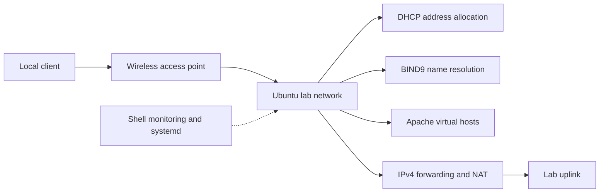
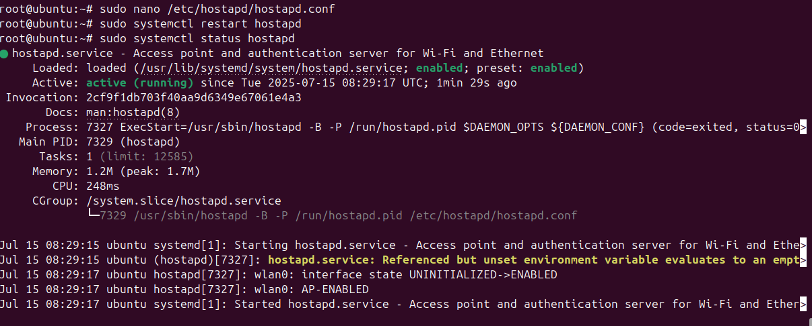

# Linux Network Infrastructure Lab

**An Ubuntu lab integrating web hosting, DNS, DHCP, wireless access, routing, and service monitoring.**

I implemented the network services and supporting administration features for this NET2103 Network & System Administration project. The original submission was a group assignment; the implementation described here is my work, as clarified in the [contribution statement](CONTRIBUTIONS.md).

[Architecture](docs/ARCHITECTURE.md) | [85 screenshots](docs/EVIDENCE.md) | [Troubleshooting](docs/TROUBLESHOOTING.md) | [Recreation checklist](docs/RECREATION.md)

## What I built

| Area | Implementation | Evidence |
| --- | --- | --- |
| Web hosting | Apache virtual hosts, directory authentication, service monitoring | [Web gallery](docs/EVIDENCE_WEB.md) |
| DNS | BIND9 forward and reverse zones with CNAME aliases | [DNS gallery](docs/EVIDENCE_DNS.md) |
| DHCP | ISC DHCP address pool, server reservations, lease settings, client exchange logs | [DHCP gallery](docs/EVIDENCE_DHCP.md) |
| Wireless access | AP-capable adapter, hostapd, dnsmasq, interface configuration | [Wireless gallery](docs/EVIDENCE_WIRELESS.md) |
| Operations | IPv4 forwarding, NAT, firewall rules, throughput logging, systemd unit, configuration backups | [Operations gallery](docs/EVIDENCE_OPERATIONS.md) |

## How the services fit together

This is a logical service overview. The report records several configuration stages, including separate ISC DHCP and dnsmasq setups; it does not establish one final, consistent physical topology. See the [architecture notes](docs/ARCHITECTURE.md).

## Selected results

The historical screenshots show two virtual hosts serving different pages, a reverse DNS response, DHCP OFFER/REQUEST/ACK exchanges, active hostapd and dnsmasq services, and throughput-monitor output.

The most useful troubleshooting lesson was that NAT alone did not complete the forwarding path. The report documents adding forwarding rules when wireless clients could associate but could not reach the uplink. It also records conflicting interface, address, and script-path settings; these are explained in [troubleshooting and evidence limits](docs/TROUBLESHOOTING.md).

## Skills demonstrated

Linux service administration; Apache configuration; DNS records and reverse lookups; DHCP reservations; wireless adapter capability checks; interface and routing diagnostics; iptables; shell monitoring; systemd configuration; log analysis; configuration backup.

## Repository contents

This portfolio includes **85 distinct technical screenshots**, organized into five galleries. Original image dimensions are retained, repeated screenshots appear once, and one Wi-Fi password line is redacted. The [evidence register](docs/EVIDENCE.md) provides source mapping and checksums.

The original report, personal identification details, passwords, VM images, packet captures, and live system configuration are excluded. This is a historical implementation case study. No original VM was supplied, no fresh end-to-end run was performed, and this repository is not an automated deployment package.

Prepared by [Willace Yee](https://github.com/willaceyee). [Attribution](ATTRIBUTION.md) | [Portfolio validation](docs/VALIDATION.md)
