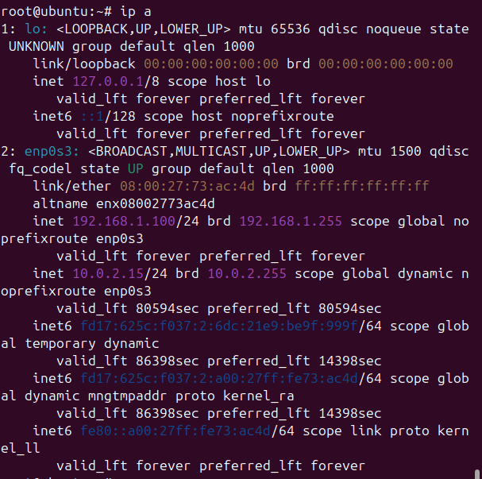
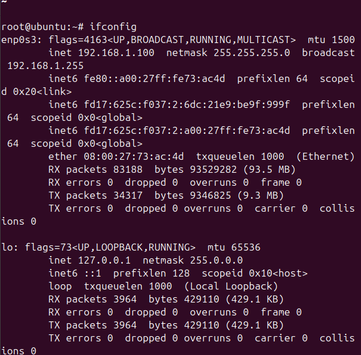
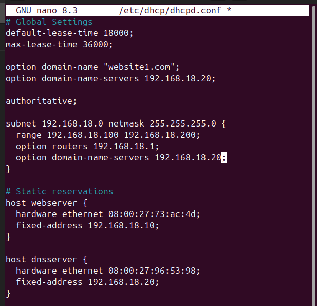
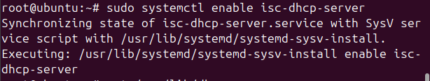
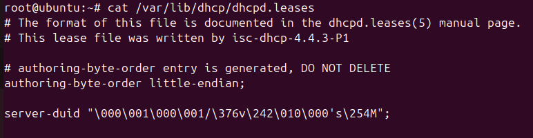
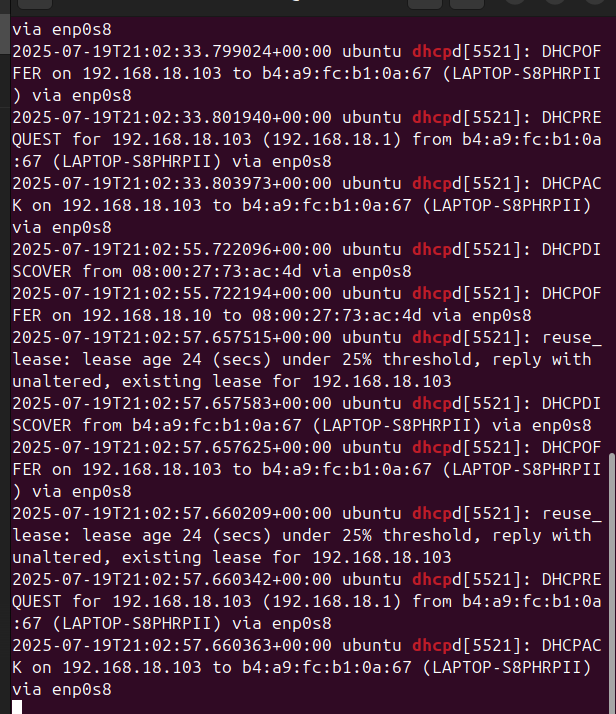

# DHCP address allocation evidence

[Evidence register](EVIDENCE.md) | [Project overview](../README.md)

Historical screenshots extracted from the NET2103 report. IDs are assigned by this portfolio; they are not original figure numbers. Image resolution is preserved.

## E050 Install ISC DHCP server

## E051 Inspect IP addresses

## E052 Inspect interface statistics

## E053 DHCP pool and reservations

## E054 Enable ISC DHCP server at boot

## E055 Lease file snapshot

## E056 DHCP exchange in the system log

