# BIND9 DNS evidence

[Evidence register](EVIDENCE.md) | [Project overview](../README.md)

Historical screenshots extracted from the NET2103 report. IDs are assigned by this portfolio; they are not original figure numbers. Image resolution is preserved.

## E035 Install BIND9

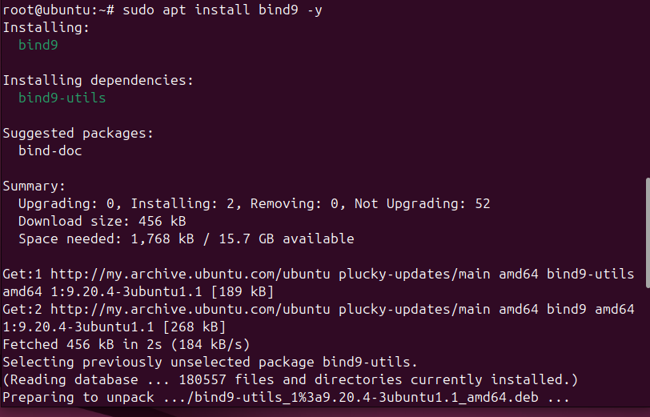

## E036 Open local DNS zone declarations

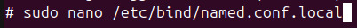

## E037 Local DNS zone declarations

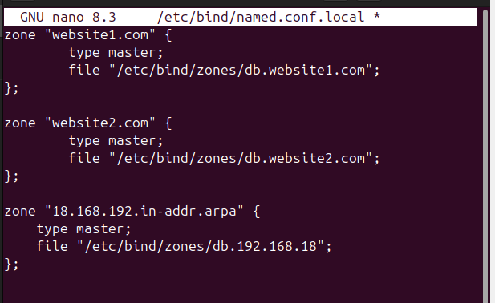

## E038 Earlier reverse-zone declaration

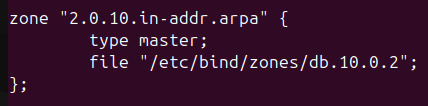

## E039 LAN reverse-zone declaration

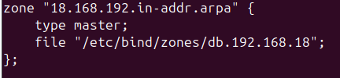

## E040 Create the DNS zone directory

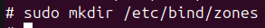

## E041 Open forward-zone files

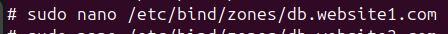

## E042 First forward-zone records

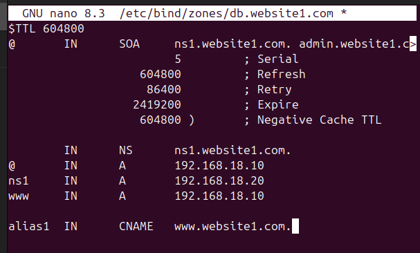

This same source image occurs twice in the report and is included once here.

## E043 Open the second forward zone

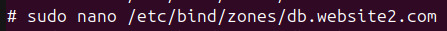

## E044 Second forward-zone records

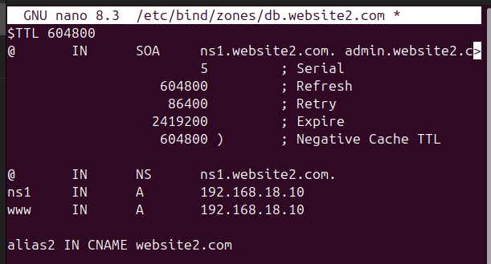

This same source image occurs twice in the report and is included once here.

## E045 Prepare the reverse-zone file

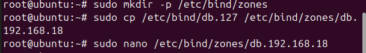

## E046 LAN reverse-zone records

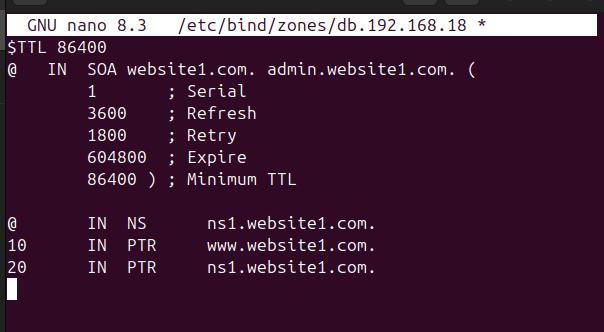

## E049 Reverse DNS lookup result

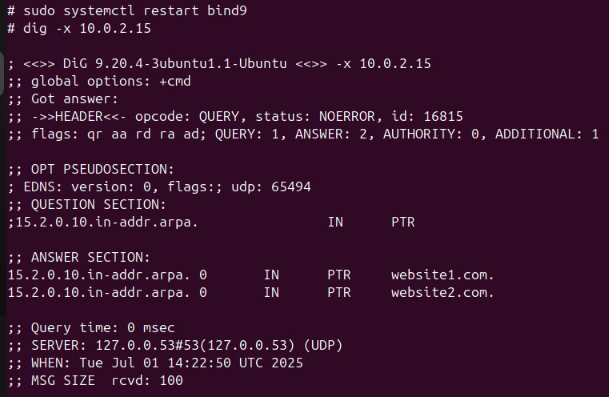
