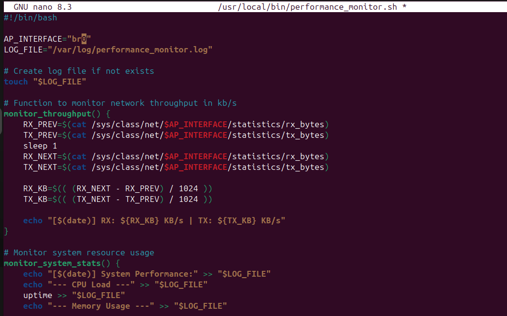
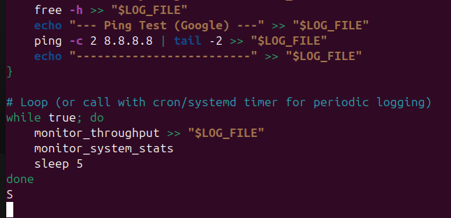
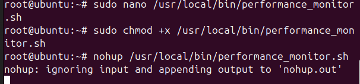
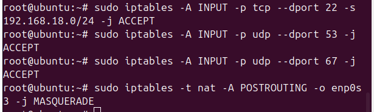
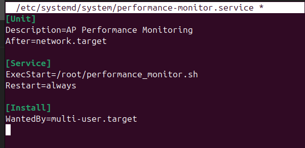
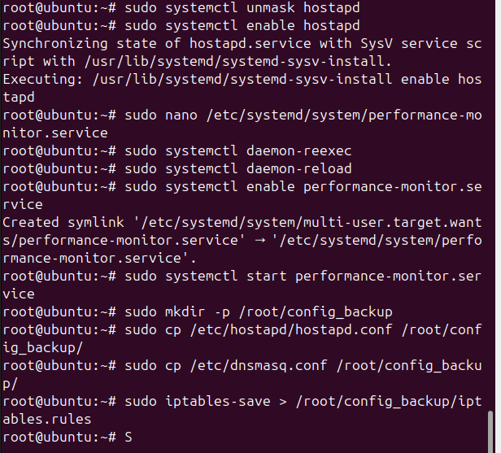
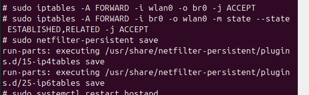

# Monitoring and service operations evidence

[Evidence register](EVIDENCE.md) | [Project overview](../README.md)

Historical screenshots extracted from the NET2103 report. IDs are assigned by this portfolio; they are not original figure numbers. Image resolution is preserved.

## E085 Performance monitoring script first part

## E086 Performance monitoring script second part

## E087 Start performance logging

## E088 Input allow rules and NAT

## E089 Performance monitor systemd unit

## E090 Service enable and backup commands

## E091 Alternative NAT interface rule

## E092 Additional forwarding rules and persistence

