# Apache web hosting evidence

[Evidence register](EVIDENCE.md) | [Project overview](../README.md)

Historical screenshots extracted from the NET2103 report. IDs are assigned by this portfolio; they are not original figure numbers. Image resolution is preserved.

## E006 Create virtual-host document roots

## E007 Write the first site homepage

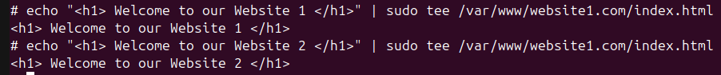

## E008 Write the second site homepage

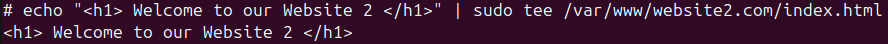

## E009 Set document-root ownership

## E010 Open local hostname mappings

## E011 Local hostname mappings

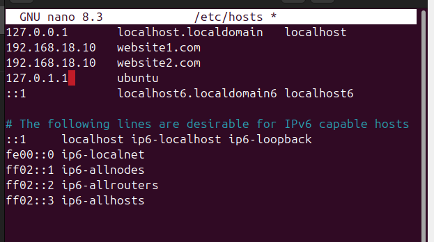

## E012 Open the first virtual-host configuration

## E013 First virtual host and protected directory

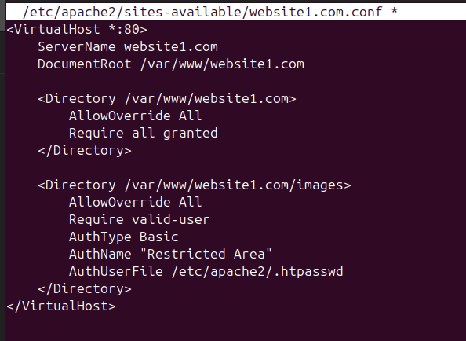

## E014 Open the second virtual-host configuration

## E015 Second virtual-host configuration

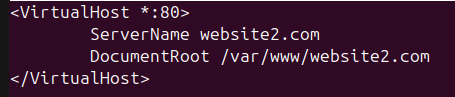

## E016 Enable sites and reload Apache

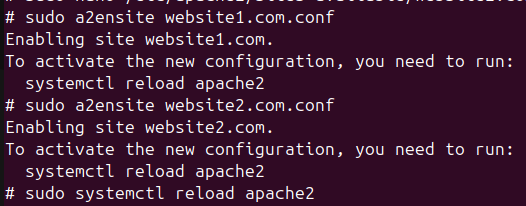

## E017 First virtual-host browser result

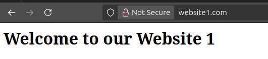

## E018 Second virtual-host browser result

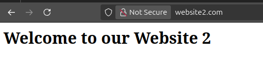

## E019 Open prefork MPM settings

## E020 Prefork MPM settings

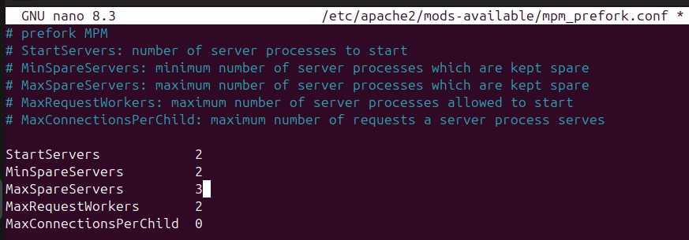

## E021 Create a protected directory

## E022 Write protected directory content

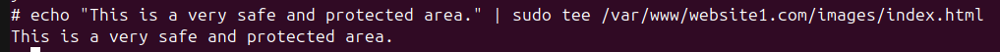

## E023 Create an authentication user

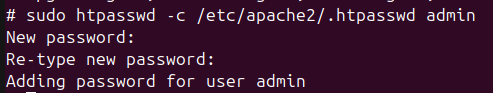

## E024 Open directory authentication settings

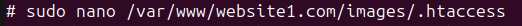

## E025 Directory authentication settings

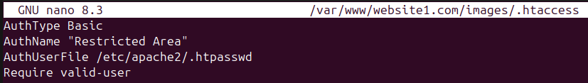

## E026 Open the site configuration

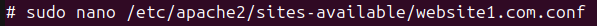

## E027 Protected-directory virtual-host settings

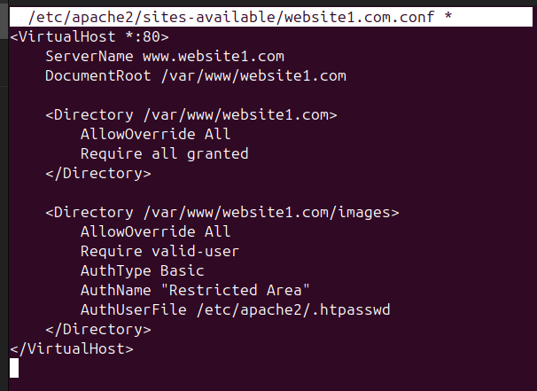

## E028 Open the web monitoring script

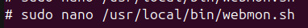

## E029 Web monitoring script

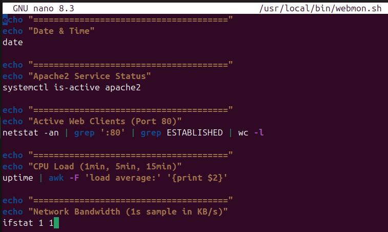

## E030 Set monitoring script permissions

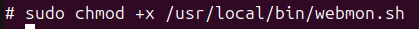

## E031 Web monitoring output

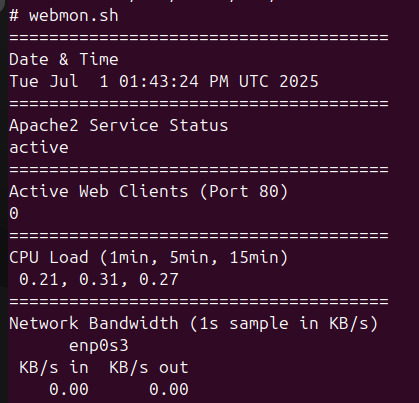

## E032 Enable Apache at boot

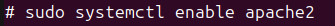

## E033 Reboot command

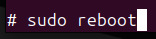

## E034 Apache service status

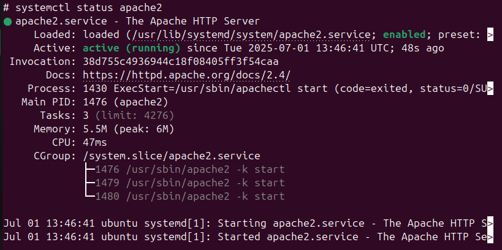
