# Wireless access point evidence

[Evidence register](EVIDENCE.md) | [Project overview](../README.md)

Historical screenshots extracted from the NET2103 report. IDs are assigned by this portfolio; they are not original figure numbers. Image resolution is preserved.

## E057 Network interfaces before AP setup

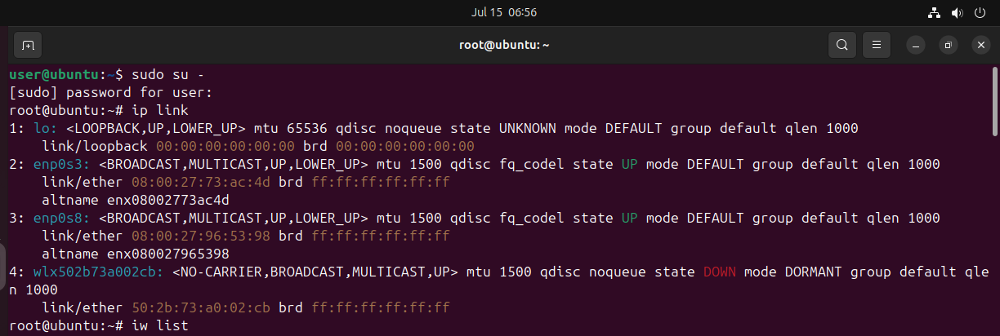

## E058 Wireless adapter AP-mode support

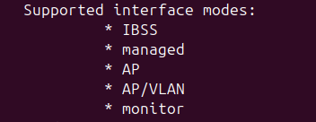

## E059 Rename the wireless interface

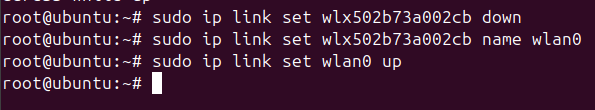

## E060 Install access-point packages

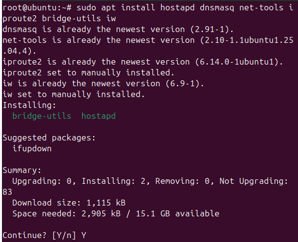

## E061 Stop wireless services for configuration

## E062 Service disable output

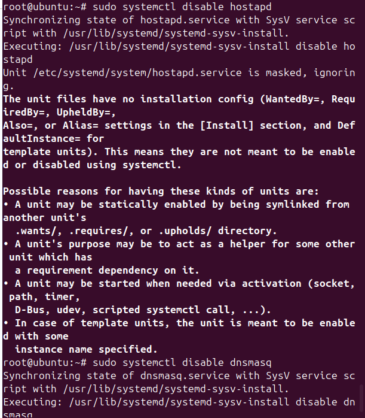

## E063 Open Netplan settings

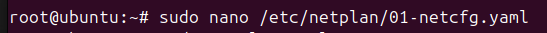

## E064 Netplan interface settings

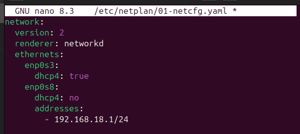

## E065 Interface and bridge states

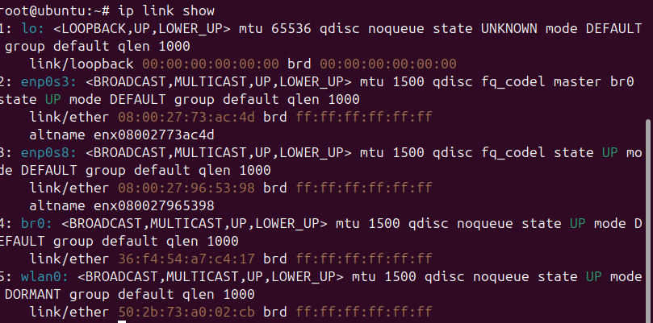

## E066 Open hostapd configuration

## E067 Hostapd settings with password redacted

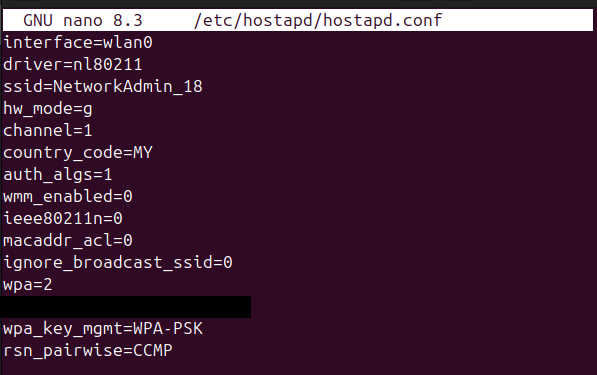

The Wi-Fi password line is covered with an opaque black rectangle. All pixels outside that rectangle are unchanged.

## E068 Wireless adapter capabilities

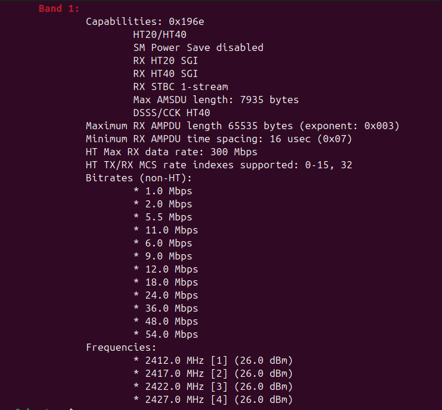

## E069 Open hostapd defaults

## E070 Hostapd defaults

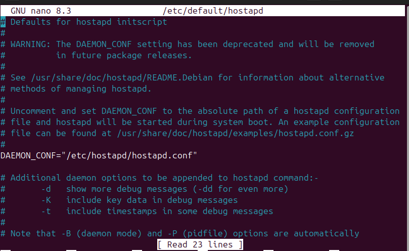

## E071 Back up and open dnsmasq configuration

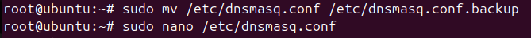

## E072 Wireless DHCP settings

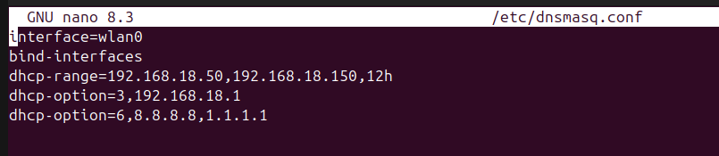

## E073 Enable IPv4 forwarding

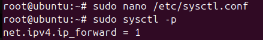

## E074 Persistent IPv4 forwarding setting

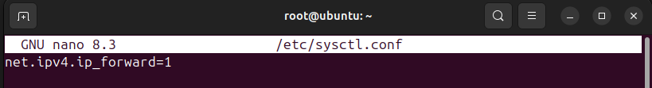

## E075 Enable wireless services at boot

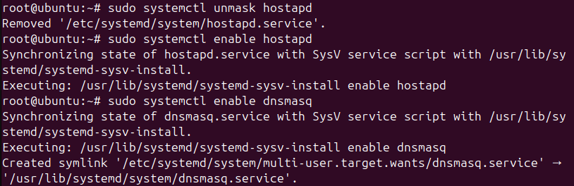

## E076 Hostapd active service status

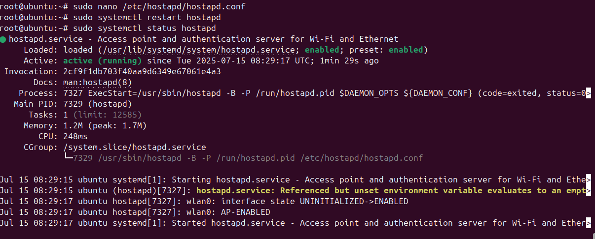

## E077 Dnsmasq active service status

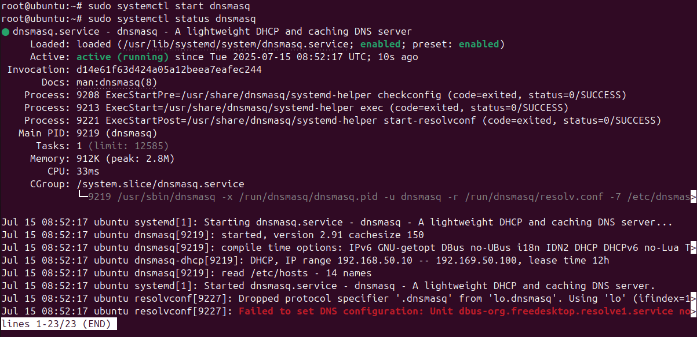

## E078 Routing table snapshot

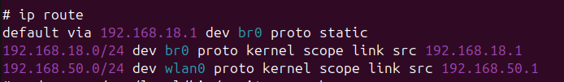

## E079 Apply IPv4 forwarding setting

## E080 NAT and forwarding rules

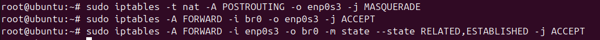

## E081 Install firewall persistence packages

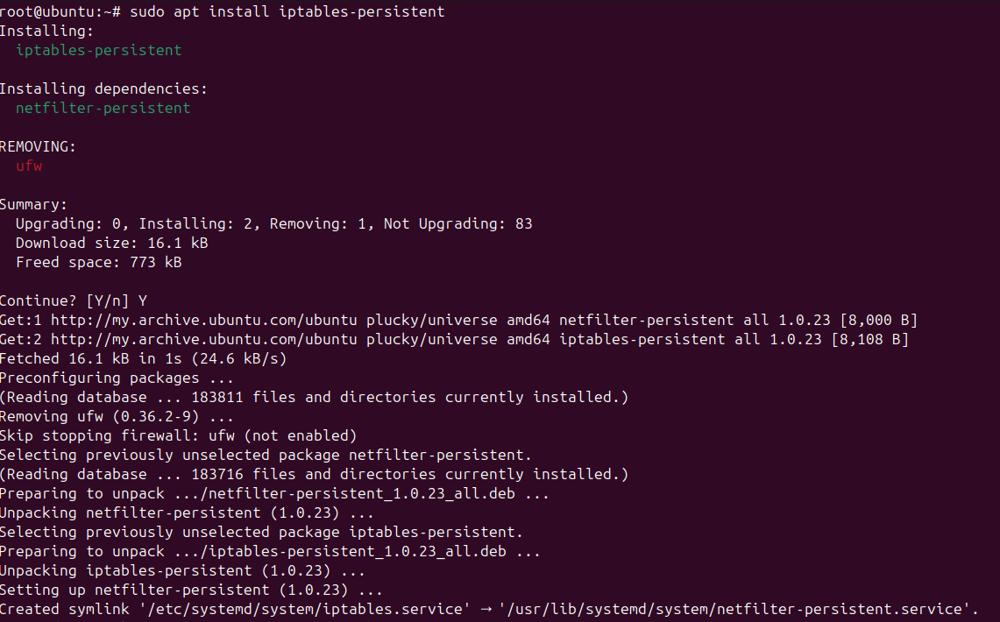

## E082 Save firewall rules prompt

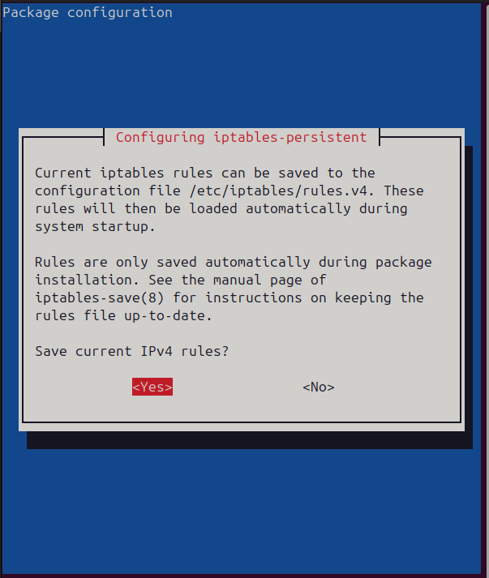

## E083 Wireless throughput monitoring script

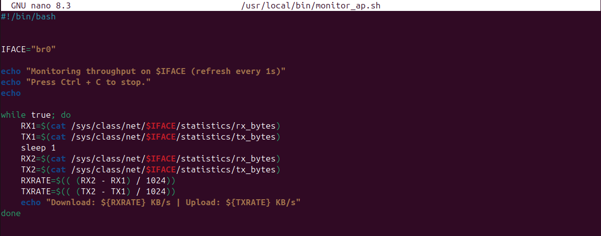

## E084 Wireless throughput monitor output

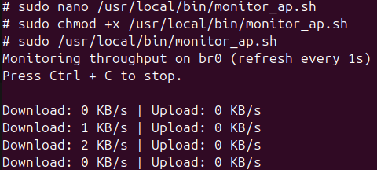
